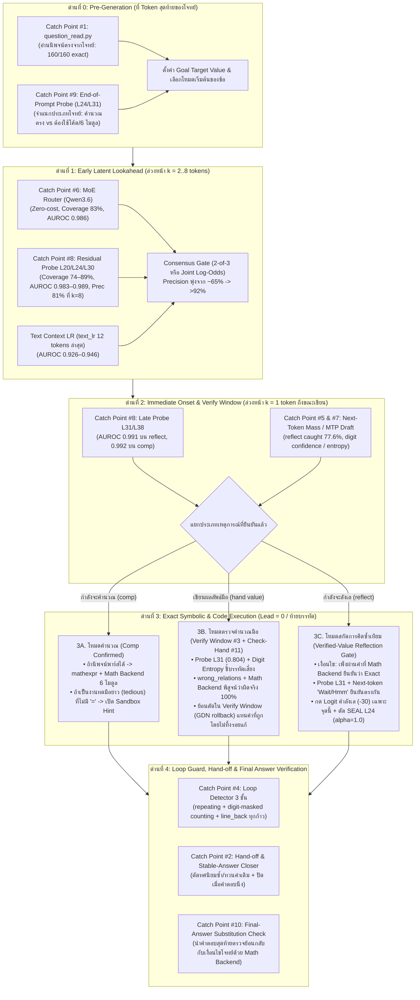

# Unified Multi-Layer MIP Detection & Intervention Pipeline Plan (2026-11-05, #298)

## 1. เป้าหมายและหลักการออกแบบ (Design Principle)
จากผลการวัดตัวตรวจจับ (Detectors) ทั้งหมดบนชุดข้อมูลควบคุมและแขนแทรกแซง (`48 LiveBench + AIME traces`, `160 DeepMind rows`, และ `Qwen3.6-35B-A3B` traces):
- **ไม่มีตัวตรวจจับเดี่ยวตัวใดที่ให้ทั้ง Lead Time สูง, Coverage สูง, และ False Alarm = 0 พร้อมกัน:**
  - ตัวตรวจจับระดับ **Latent / Sub-token (`MoE Router`, `probe_L24/L30`, `probe_L31`, `next` distribution)** มี **Lead Time 1–32 tokens** และ **Coverage 74–89%** แต่ถ้าใช้เดี่ยวๆ ที่ False Alarm 1% ของทุกตำแหน่งจะมี **Precision อยู่ที่ 43–67%** (มีโอกาสเตือนหลอก ~33–57% ของครั้งที่เตือน)
  - ตัวตรวจจับระดับ **Text & Symbolic (`question_read`, `mathexpr`, `wrong_relations`, `mathbackend` 6 โมดูล)** มี **Precision ~100% (Exact)** แต่มี **Lead Time = 0** (ต้องรอให้โมเดลเขียนนิพจน์จนถึง `=` หรือจบบรรทัดก่อน และมองไม่เห็นตอนโมเดลกำลังเริ่มตั้งทดเลขยาวด้วยมือหรือกำลังจะเริ่มระแวง)
- **ทางออก: Multi-Stage Gated Cascade (คัดกรองล่วงหน้าด้วยสัญญาณภายใน → ยืนยันข้ามชั้น → ลงมือด้วยตัวคำนวณ Exact 100%)**
  - นำตัวตรวจจับทุกตัวมาเรียงเป็น **5 ด่านตามลำดับเวลา (Chronological Stages)** โดยให้ด่านที่มี Lead Time สูงทำหน้าที่ **"ชี้เป้าและเปิดหน้าต่างเฝ้าระวัง (Arming / Gating)"** และใช้ด่านถัดไปทำหน้าที่ **"ยืนยันผล (Cross-Verification)"** ก่อนอนุญาตให้แทรกแซงการสร้าง Token ของโมเดล

---

## 2. สถาปัตยกรรมไปป์ไลน์การตรวจจับร่วม 5 ด่าน (5-Stage Unified Detection Pipeline)

---

## 3. ตารางจับคู่ตัวตรวจจับ (Cross-Verification Matrix) — ตัวไหนอุดช่องโหว่ให้ตัวไหน

| เหตุการณ์เป้าหมาย | ตัวตรวจจับหลัก (High Recall / Early Lead) | จุดอ่อนเมื่อใช้เดี่ยว | ตัวตรวจจับคู่ยืนยัน (High Precision / Verifier) | กฎการตัดสินใจร่วม (Joint Decision Rule) |
| :--- | :--- | :--- | :--- | :--- |
| **1. กำลังจะเริ่มคำนวณ (`comp` onset)** | **`MoE Router`** (83%) + **`probe_L24/L30`** (74–89%, Lead 2–8 tokens) | เตือนหลอก ~19–35% เมื่อโมเดลกล่าวถึงตัวเลขในโจทย์โดยไม่ได้จะคำนวณ | **`text_lr`** (บริบท 12 tokens) + **`next` digit/op mass** (MTP proposals) + **`mathexpr` / `mathbackend` AST** | **ขั้นที่ 1:** เมื่อ `Router + probe_L24` เกินเกณฑ์ ให้เปิดโหมด `COMP_ARMED` (ยังไม่แก้ข้อความ) **ขั้นที่ 2:** ถ้าเจอ `=` หรือรูปฟังก์ชัน ให้ `mathbackend` คำนวณทันที; ถ้าไม่เจอ `=` ภายใน 16 tokens แต่ `next` มีมวลตัวเลขสูงต่อเนื่อง (`tedious`) จึงถอยต้นบรรทัดแล้วเปิดบล็อก Python (`--hint-calc`) |
| **2. คำนวณเลขคณิต / พีชคณิต / การนับ (`=` หรือนิพจน์)** | **Text Layer 2 (`mathexpr.py` ที่ `=`)** (Precision ~100%) | ในโจทย์ AIME มี ~16% ของ `=` ที่โมเดลตั้งใจจะจัดรูปพีชคณิตต่อ ไม่ได้ต้องการตัวเลข (ทำให้ `inline` วนลูป) และอีก 8/19 ข้อเป็นโจทย์นอกเลขคณิตบวกลบคูณหาร | **`next` top-k tokens** (ดูว่าโมเดลกำลังจะเขียนตัวเลขหรือสัญลักษณ์พีชคณิต) + **Math Backend 6 โมดูล (`counting`, `numbers`, `algebra`, `geometry`, `search`, `symbolic`)** | • ถ้าหลัง `=` โมเดลมีมวลความน่าจะเป็นของตัวเลข (`next` digit mass สูง) หรือใช้ `--logit-value 8` ให้ส่งค่าตัวเลขเข้าช่วย • ถ้าหลัง `=` มวลความน่าจะเป็นเป็นตัวแปร/จัดรูปพีชคณิต ให้ใช้ `symbolic`/`algebra` หรือปล่อยให้จัดรูปต่อโดยไม่ยัดตัวเลขขวางจังหวะ |
| **3. โมเดลทดเลขด้วยมือผิด (`wrong_value`)** | **`probe_L31`** ก่อนตัวเลขหลักแรก (AUROC 0.804) + **Digit Entropy** (AUROC 0.700) | โมเดลมีอาการ "มั่นใจแบบผิดๆ" ถ้าใช้แค่ Confidence จะจับได้ไม่ครบและมี False Alarm | **Text Layer 3 (`wrong_relations`)** + **`mathbackend` Exact Oracle** (Precision 100%) | • ใช้ `probe_L31 + Entropy` คัดกรองเฉพาะบรรทัดที่น่าสงสัย • ใช้ `wrong_relations + mathbackend` พิสูจน์ความผิดพลาดแบบ 100% • **วิธีแก้ (Catch Point #3):** ย้อนตัดตัวเลขที่ผิดใน **Verify Window** (พร้อม GDN rollback) แล้วใส่ค่าที่ถูกแทนที่โดยไม่พิมพ์คำว่า `Correction:` (ป้องกันโมเดลระแวงและคิดมือซ้ำ) |
| **4. โมเดลกำลังจะพูด `Wait / Hmm` เพื่อเช็กซ้ำ (`reflect`)** | **`probe_L31`** (AUROC 0.991, Lead 2 tokens) + **`next` reflect mass** (AUROC 0.932, Caught 77.6% ที่ Lead 1) | ถ้ากดคำว่า `Wait` ทุกครั้ง โมเดลจะไม่ยอมแก้ตัวเมื่อตั้งสมการผิดจริง | **Verified-Value Window (`window > 0`)** — ตรวจว่าบรรทัดก่อนหน้าเพิ่งได้รับการรับรองจาก `mathbackend` หรือ Sandbox หรือไม่ | **กดคำลังเลแบบมีเงื่อนไข (Conditional Suppression):** • กด Logit คำกลุ่ม `RECHECK_WORDS` (-30) และ/หรือดัด `SEAL` Layer 24 **เฉพาะเมื่อ (ก) มีค่าที่ Software ยืนยันแล้วในหน้าต่าง 60 tokens ล่าสุด และ (ข) `probe_L31` หรือ `next` แจ้งเตือน `reflect`** • หากยังไม่มีค่าที่ยืนยัน ให้ปล่อยให้โมเดลทบทวนตามธรรมชาติ |
| **5. โมเดลคิดถูกแล้วแต่ไม่ยอมสรุปคำตอบ (`NOT_TRUSTED` / Loop)** | **Loop Detectors (`repeating`, `counting`, `line_back`)** + **Candidate Answer Tracker** | `line_back` เดิมตรวจเฉพาะเมื่อ `len(tokens) % 4096 == 0` ทำให้หลุดจังหวะ และ**การได้คำตอบตรงกัน 2 ครั้งอาจเกิดจากการใช้สมมติฐานหรือสูตรที่ผิดตัวเดิมซ้ำสองรอบ** | **Assumption-Independent Candidate Closer** + **Small-Case / Constraint Verifier (`search` / Catch Point #10)** + **`probe_L24` reflect density** | • แก้ `line_back` ให้ตรวจทุกครั้งที่จบบรรทัด `\n` • **กฎป้องกันสมมติฐานผิดตัวเดิม (Assumption-Independence Guard):** คำตอบตรงกัน $\ge 2$ ครั้งจะนับเป็น `INDEPENDENT_VERIFIED` ก็ต่อเมื่อมาจาก **คนละวิธีที่เป็นอิสระต่อกัน** (เช่น วิธีที่ 1 มาจากการจัดรูปพีชคณิต/สูตร vs วิธีที่ 2 มาจากการแจงนับเคสเล็กด้วย `search`/Sandbox หรือผ่านการตรวจย้อนกลับกับเงื่อนไขโจทย์ใน Catch Point #10) • หากได้คำตอบเดิมซ้ำจากสูตร/สมการรูปแบบเดิม (`SAME_ASSUMPTION_REPEAT`) จะถือเป็นเพียงหลักฐานสนับสนุน ยังไม่บังคับตัดจบจนกว่าจะเข้าเงื่อนไข Loop จริง (`repeating` / `counting` / `line_back`) หรือใกล้ชนเพดาน Context |

---

## 3.5 ข้อกำหนดความรัดกุมเพิ่มเติม (Rigorous Safeguards: OOD Generalization & Assumption Independence)

### 1. `UnifiedDetector`: การวัด Precision, Coverage และ False Alarm พร้อมกันบนข้อมูลนอกชุดฝึก (Out-of-Distribution / Unseen Problem Types)
- **ปัญหาที่ต้องป้องกัน:** ค่า Precision $\ge 90\%$ ที่วัดด้วย Cross-Validation บนชุดข้อมูล 48 ข้อ (`LiveBench + AIME`) หรือชุดที่ใช้ปรับตั้งค่า Threshold อาจเกิดการฟิตเข้ากับรูปแบบประโยคหรือประเภทโจทย์เดิม (Distribution Overfit) และไม่รับประกันว่าจะแม่นยำเท่าเดิมเมื่อเจอโจทย์คณิตศาสตร์รูปแบบใหม่หรือโดเมนอื่น
- **การออกแบบป้องกันใน Pipeline:**
  1. **Strict Out-of-Distribution (OOD) Evaluation Split:** แยกชุดข้อมูลวัดผลออกเป็น 3 ระดับที่ห้ามนำมาใช้ฝึกหรือจูน Threshold เด็ดขาด:
     - **In-Distribution CV:** 48 ข้อ (`LiveBench math` + `AIME24/25`) ใช้ดูแนวโน้มเบื้องต้น
     - **Held-Out Competition Suite (Unseen Math Types):** ชุดโจทย์จากแหล่งอื่นที่โมเดลไม่เคยถูกเก็บ Trace มาฝึก Probe (เช่น `MATH-500` แยกตามหมวดหมู่ย่อย หรือ `DeepMind Mathematics 160` และโจทย์ Combinatorics/Geometry รูปแบบใหม่)
     - **Non-Arithmetic / Proof / Code Reasoning Traces:** โจทย์ที่มีตัวเลขและสัญลักษณ์ `=` จำนวนมากแต่**ไม่ใช่การคำนวณหาค่า** (เช่น การจัดรูปเอกลักษณ์, การเขียนโค้ดทั่วไป, หรือการไล่นิยาม) เพื่อวัด **False Alarm Rate บนบริบทลวง (Hard Negative Contexts)**
  2. **Joint 3-Metric Gate (ต้องผ่านพร้อมกันทั้ง 3 ค่าบน Unseen Data):**
     - ต้องรายงานและผ่านเกณฑ์พร้อมกันทั้ง **Precision**, **Coverage (`caught / should-have-caught`)**, และ **False Alarm per 1,000 tokens (และต่อข้อ)** บนชุด Unseen OOD
     - ห้ามแลก Precision ด้วยการกด Coverage จนต่ำ หรือปล่อยให้ False Alarm บนโจทย์ประเภทใหม่พุ่งเกินเพดาน ($\le 0.5\%$ ของตำแหน่ง非เป้าหมาย)
  3. **Non-Destructive Gating เมื่ออยู่นอกโดเมนที่คุ้นเคย:**
     - ด่านที่ 1–2 (`UnifiedDetector` ระดับ Latent/Probe/Router) **ห้ามแก้ไขข้อความหรือบังคับแทรก Token โดยตรง** ทำได้เพียงเปิดสถานะเฝ้าระวัง (`ARMED`)
     - การลงมือแทรกค่าจริงในด่านที่ 3 ต้องผ่าน **Exact Symbolic/AST Parser (`mathexpr` / `mathbackend` 6 โมดูล)** เสมอ — ดังนั้นต่อให้เจอโจทย์ประเภทใหม่ที่ทำให้ Latent Probe เกิด False Alarm แต่ถ้านิพจน์ไม่ใช่สมการที่พาร์สได้แบบ Exact ระบบก็จะไม่เข้าไปพังข้อความของโมเดล (Zero Destructive False Alarm)

### 2. `Stable Candidate Answer Closer`: การแยกแยะ "คำตอบตรงกันจากคนละวิธี" ออกจาก "คำตอบตรงกันเพราะใช้สมมติฐานผิดตัวเดิมซ้ำ"
- **ปัญหาที่ต้องป้องกัน:** ในการให้เหตุผลของ LLM บ่อยครั้งที่โมเดลตั้งสมมติฐานเริ่มต้นผิด (เช่น ตีความโจทย์ผิดว่าลำดับเป็นเลขคณิต, นับกรณีซ้ำ, หรือตั้งสมการหลักผิดตั้งแต่บรรทัดแรก) แล้วเมื่อโมเดลพูด `Wait, let me recalculate` โมเดลกลับ**คำนวณซ้ำด้วยสมการหรือสมมติฐานที่ผิดตัวเดิม** ทำให้ได้ตัวเลขคำตอบเดิมออกมาเป็นครั้งที่ 2 หรือ 3 หากระบบเห็นแค่ว่า "ตัวเลขตรงกัน 2 ครั้ง" แล้วสั่งตัดจบ (`</think>`) ทันที จะเป็นการล็อกคำตอบที่ผิดให้จบเร็วขึ้น
- **การออกแบบป้องกันใน Pipeline (`Assumption-Independent Verification`):**
  1. **จำแนกที่มาของ Candidate Answer (`Lineage & Method Tagging`):** ทุกครั้งที่ได้ค่าผู้ท้าชิงคำตอบ $v$ ระบบจะบันทึก **ลายนิ้วมือของวิธีคิด (Method Signature)** คู่กับค่า $v$:
     - `METHOD_ALGEBRAIC`: มาจากการแก้สมการ/สูตรปิด (`mathexpr`, `algebra`, `symbolic`, `counting` formula) พร้อมเก็บเซตของตัวเลขตั้งต้นและโครงสร้างนิพจน์ (`AST canonical hash`)
     - `METHOD_EXHAUSTIVE_SEARCH`: มาจากการแจงนับหรือกวาดเช็กเคสจริง (`search.count_where`, `search.find_all`, หรือบล็อกโค้ด Sandbox ที่วนลูปเช็กเงื่อนไขโดยตรง)
     - `METHOD_SMALL_CASE_CHECK`: มาจากการแทนค่าพารามิเตอร์ขนาดเล็ก ($n=1,2,3$) หรือการตรวจคำตอบย้อนกลับเข้าเงื่อนไขโจทย์ (`Catch Point #10: Final-Answer Substitution Check`)
  2. **กฎการยอมรับคำตอบซ้ำ 3 ระดับ (3-Tier Candidate Closing Policy):**
     - **ระดับที่ 1 — ขัดแย้งกับเคสเล็ก (`FALSIFIED_BY_SEARCH` -> ห้ามปิดและแจ้งเตือน):** หากมีผลจาก `METHOD_EXHAUSTIVE_SEARCH` หรือการเช็กเคสเล็กที่ขัดแย้งกับสูตรพีชคณิต ระบบจะ **ยกเลิก (Invalidate)** คำตอบจากสูตรทันที แม้ว่าโมเดลจะคำนวณสูตรนั้นซ้ำได้ค่าเดิมกี่ครั้งก็ตาม
     - **ระดับที่ 2 — ซ้ำจากสมมติฐาน/สูตรเดิม (`SAME_ASSUMPTION_REPEAT` -> ยังไม่ตัดจบเร็ว):** หากได้ค่า $v$ ตรงกัน $\ge 2$ ครั้ง แต่มี `AST canonical hash` ตระกูลเดียวกัน (เช่น แค่คูณเลขชุดเดิมซ้ำ หรือแก้สมการเดิมซ้ำ) ระบบจะถือเป็นเพียง **หลักฐานสนับสนุน (Supporting Evidence)** แต่**ไม่สั่งตัดจบ `</think>` ทันที** โดยปล่อยให้โมเดลมีโอกาสตรวจสอบสมมติฐานด้วยวิธีอื่นต่อ ยกเว้นเมื่อโมเดลติดอยู่ใน **Verified Infinite Loop** (`repeating` / `counting` / `line_back` ซ้ำบรรทัดจริง) หรือเหลือพื้นที่ก่อนชนเพดาน Context น้อยกว่าขีดจำกัด
     - **ระดับที่ 3 — ยืนยันข้ามวิธีที่เป็นอิสระต่อกัน (`CROSS_METHOD_CONFIRMED` -> ตัดจบได้อย่างปลอดภัย):** เมื่อค่า $v$ ตรงกันโดยมาจาก **อย่างน้อย 2 วิธีที่เป็นอิสระต่อกัน** (เช่น สูตรพีชคณิต/คอมบิเนทอริกส์ ได้ค่าตรงกับ `search` แจงนับ หรือผ่านการแทนค่าย้อนกลับครบทุกเงื่อนไขโจทย์ใน Catch Point #10) และ `reflect_gate` ตรวจพบว่าโมเดลกำลังจะเริ่มระแวงซ้ำ จึงสั่งปิด `</think>` เพื่อสรุปคำตอบทันที

---

## 4. การเชื่อมต่อเข้ากับ Exact Math Backend ทั้ง 6 โมดูล (382 Operations)

เมื่อด่านที่ 1–2 (`Router` + `Probe L24/L31`) ชี้เป้าและด่านที่ 3 อ่านนิพจน์หรือบล็อกโค้ด ระบบจะส่งต่อไปยัง **Math Backend ทั้ง 6 โมดูล** (ซึ่งผ่านการทดสอบ Simulation 3 Seeds = **0 Disagreements** และ Mutation Testing **100%** แล้ว):

| โมดูล | จำนวน Operations | รูปแบบที่ตัว Detect ดักจับและส่งต่อให้คำนวณแบบ Exact |
| :--- | :---: | :--- |
| **`counting`** | **70 ops** | `\binom{n}{k}`, $n!$, Multinomial, Stirling, Catalan, Derangements, Inclusion-Exclusion, Recurrence, Chromatic polynomial |
| **`numbers`** | **100 ops** | $\gcd, \text{lcm}$, `mod`, $\pmod{m}$, CRT, $\varphi(n)$, $\mu(n)$, Prime factorization, Discrete log, Tonelli-Shanks, Continued fractions, Pell equation |
| **`algebra`** | **67 ops** | ระบบสมการเชิงเส้น, รากพหุนามexact, Vieta, ผลบวกอนุกรม, เมทริกซ์ ($\det, \text{inv}, \text{rank}, \text{charpoly}$), Partial fractions |
| **`geometry`** | **84 ops** | พื้นที่/เส้นรอบรูป/ปริมาตรแบบ Exact (`Fraction` / `Sqrt`), จุดตัดเส้นตรง-วงกลม, Circumcenter/Incenter, 3D plane/sphere, Pick's theorem |
| **`search`** | **43 ops** | การกวาดหาค่าในขอบเขตจำกัด (`find_all`, `count_where`, `sum_expr`, `arg_min`, `arg_max`, BFS/Dijkstra/DP Knapsack) แทนการสุ่มแทนค่าด้วยมือ $n=1,2,3$ |
| **`symbolic`** | **18 ops** | การจัดรูปและกระจายพหุนามติดตัวแปร, การหารพหุนาม, $\gcd$ พหุนาม, อนุพันธ์/ปริพันธ์พหุนาม, แทนค่าสัญลักษณ์ |

---

## 5. แผนการลงมือพัฒนาและทดสอบทีละขั้น (Step-by-Step Implementation & Verification Plan)

### Phase 1: ปิดงานและควบรวมฐานคำนวณ (วันนี้ — กำลังเสร็จสมบูรณ์)
1. **ควบรวม Math Backend ทั้ง 6 โมดูล (382 ops)** เข้าสู่กิ่ง `xeno/mip-sandbox` พร้อมรัน Coordinator Simulation รวมทั้ง 6 โมดูล (`--seed 1,2,3 --n 60` -> 0 disagreements)
2. **เก็บผลทดสอบเพดานเต็ม 262,144 tokens บน Colab A100-80GB (`c2`)** เพื่อแยกแยะว่าข้อที่เคยชนเพดาน 20,000 tokens ข้อใดแก้ได้ด้วย Context ที่ยาวขึ้น + `--loop-close` (`inlineclose` ขยับขึ้นเป็น 25/48 แล้วตั้งแต่ 2 ข้อแรก) และข้อใดต้องพึ่ง Unified Detector + Math Backend 6 โมดูล

### Phase 2: สร้างโมดูล `UnifiedDetector` (`tools/igc/unified_detect.py`) และทดสอบ Offline ทั้ง In-Distribution และ Unseen OOD
1. **รวมสัญญาณทั้ง 4 ชั้นเข้าด้วยกัน (`probe_L24`, `probe_L31`, `router` [เมื่อเป็น MoE], `next` distribution, และ `text_lr`):**
   - สร้างฟังก์ชันตัดสินใจร่วม (Joint Calibrated Gate) สำหรับ 3 เหตุการณ์: `comp_gate`, `reflect_gate`, และ `wrong_value_gate`
   - บังคับหลักการ **Non-Destructive Latent Gating**: สัญญาณจาก Probe/Router ทำได้เพียงเปิดโหมดเฝ้าระวัง (`ARMED`) ส่วนการแก้ค่าต้องผ่านตัวพาร์ส Exact (`mathexpr` / `mathbackend`) เท่านั้น
2. **วัดผลแยก 2 ชุดชัดเจน: (ก) Cross-Validation บน 48 LiveBench/AIME traces และ (ข) Held-Out Unseen OOD Suites (ข้อมูลและประเภทโจทย์ที่ไม่เคยใช้ฝึก Detector):**
   - รายงานตารางเปรียบเทียบ **Single Detector vs. Unified Ensemble Detector** โดยดู **Precision, Coverage (`caught / should-have-caught`), และ False Alarm rate (ต่อ 1,000 tokens และบน Hard Negative Contexts)** พร้อมกันทั้งหมด
   - **เกณฑ์ผ่าน (Joint OOD Gate):** ทั้งบนชุด CV และชุด Unseen OOD ต้องได้ Precision $\ge 90\%$ โดยที่ Coverage ไม่ลดลงจากตัวตรวจจับเดี่ยว และมี Destructive False Alarm = 0

### Phase 3: เชื่อม `UnifiedDetector` + `MathBackend` เข้ากับ Reference Runner (`tir4b.py`)
1. **แก้ไขจุดบอดของ Loop & Line-Back Guard พร้อมระบบ `Assumption-Independent Candidate Closer`:**
   - แก้ `external_score.py:repeating()` ให้ตรวจ `line_back` ทุกครั้งที่จบบรรทัด `\n` (แทน `len(tokens) % 4096 == 0`)
   - เพิ่ม **Assumption-Independent Stable Candidate Answer Closer**:
     - ผูกป้ายวิธีคิด (`METHOD_ALGEBRAIC` พร้อม `AST canonical hash`, `METHOD_EXHAUSTIVE_SEARCH`, `METHOD_SMALL_CASE_CHECK` / Catch Point #10) ให้กับทุก Candidate Answer
     - หากเคสเล็กหรือ `search` ขัดแย้งกับค่าจากสูตร (`FALSIFIED_BY_SEARCH`) ให้ตัดตกทันที
     - หากค่าตรงกัน 2 ครั้งแต่มาจากสูตร/สมการตระกูลเดิม (`SAME_ASSUMPTION_REPEAT`) ให้ถือเป็นเพียงหลักฐานสนับสนุน ยังไม่สั่งตัดจบเร็ว (ปิดเฉพาะเมื่อเข้าสู่ Verified Loop จริงหรือชนเพดาน Context)
     - สั่งปิด `</think>` ทันทีเฉพาะเมื่อค่าตรงกันจาก **อย่างน้อย 2 วิธีที่เป็นอิสระต่อกัน (`CROSS_METHOD_CONFIRMED`)** และ `reflect_gate` แจ้งว่าโมเดลกำลังจะเริ่มวนเช็กซ้ำ
2. **เชื่อม Natural / Symbolic Trigger เข้ากับ Math Backend 6 โมดูล:**
   - ขยาย `inline_found` และ `wrong_relations` ให้เรียกใช้ `counting`, `numbers`, `algebra`, `geometry`, `search`, `symbolic` เมื่อตรวจพบฟังก์ชันหรือรูปแบบที่ตรงกัน (แก้ปัญหา 8 ข้อในกลุ่ม `UNCOVERED`)
3. **เชื่อม Conditional Reflection Gate + Verify-Window Cut:**
   - ใช้ `logit_value` / Verify-Window replacement (ตัดค่าที่คิดมือผิดออกตั้งแต่ก่อนโมเดลเห็นข้อความตัวเอง) คู่กับ `suppress_recheck` ที่ทำงานเฉพาะเมื่อผ่าน `reflect_gate` หลังค่าที่ยืนยันแล้ว

### Phase 4: ทดสอบ A/B บน LiveBench + AIME 48 ข้อ และพอร์ตลง C++/CUDA Engine (`strata-xeno`)
1. รันทดสอบแขน **`unified-mip`** บน A100 เทียบกับ `ctrlb`, `inlineclose`, และ `seal1` (วัดทั้งคะแนน 48 ข้อ, Gain/Loss รายข้อ, อัตราการคิดซ้ำ, และจำนวน Token ที่ใช้)
2. พอร์ตเฉพาะกลไกที่พิสูจน์แล้วว่าเพิ่มคะแนนโดยไม่เสียข้อที่เคยถูก ลงใน `include/strata/program/igc_learned_diagnostic.hpp` และ `include/strata/core/igc_inline.hpp` สำหรับ **Qwen3.6-35B-A3B NVFP4**
